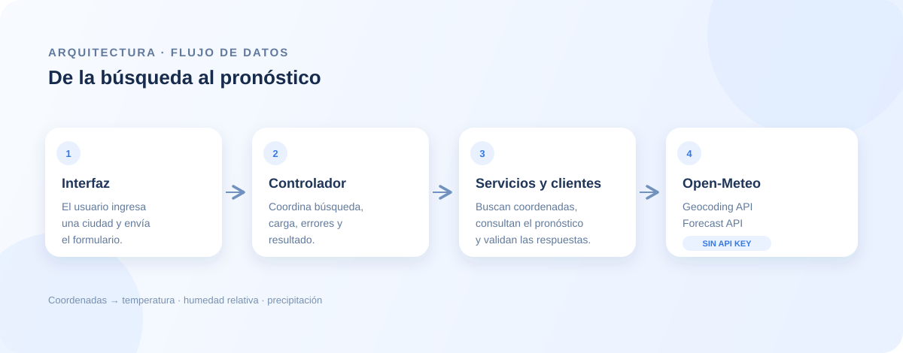

<div align="center">

# 🌤️ Pronóstico del clima

### Consulta las condiciones meteorológicas actuales de una ciudad

Aplicación web desarrollada con TypeScript que busca una ciudad y muestra su temperatura, humedad relativa y precipitación actual. Los datos se obtienen de las APIs públicas de [Open-Meteo](https://open-meteo.com/); no se necesita una clave de API.

<br />


</div>

## Vista previa


## Funcionalidades

- Búsqueda de ciudades mediante la API de geocodificación de Open-Meteo.
- Consulta de temperatura, humedad relativa y precipitación actuales.
- Estados de carga, validación de entrada y mensajes de error.
- Diseño adaptable para distintos tamaños de pantalla.

## Flujo de la aplicación



La aplicación resuelve el nombre de la ciudad para obtener sus coordenadas y luego consulta el pronóstico actual. Los servicios validan las respuestas antes de que el controlador actualice la interfaz.

## Tecnologías

| Tecnología | Uso |
| --- | --- |
| TypeScript | Lógica de la aplicación y tipado estático |
| Vite | Servidor de desarrollo y compilación |
| Vitest | Pruebas unitarias y de integración |
| Open-Meteo | Geocodificación y datos meteorológicos |

## Requisitos

- Node.js 20.19 o posterior, o 22.12 o posterior
- npm

## Instalación y ejecución

```sh
git clone https://github.com/USUARIO/REPOSITORIO.git
cd REPOSITORIO
npm install
npm run dev
```

Vite mostrará en la terminal la dirección local de la aplicación.

## Pruebas y compilación

```sh
npm test
npm run build
```

La compilación de producción se genera en `dist/`. Esa carpeta se crea al compilar y no es necesario subirla al repositorio.

## Estructura del proyecto

```text
src/
├── clients/      # Comunicación HTTP con las APIs
├── components/   # Formulario, carga, errores y resultados
├── services/     # Geocodificación y pronóstico
├── types/        # Tipos compartidos
├── utils/        # Funciones auxiliares
├── main.ts       # Inicialización de la aplicación
└── WeatherController.ts
docs/             # Imágenes del README
```

## Publicar en GitHub

1. Crea un repositorio nuevo en GitHub sin inicializarlo con README, `.gitignore` ni licencia.
2. Desde la carpeta del proyecto, configura el remoto y publica la rama `main`:

```sh
git add .
git commit -m "Preparar proyecto inicial"
git remote add origin https://github.com/USUARIO/REPOSITORIO.git
git push -u origin main
```

Si ya existe un remoto llamado `origin`, reemplaza el comando `git remote add` por:

```sh
git remote set-url origin https://github.com/USUARIO/REPOSITORIO.git
```

El `.gitignore` excluye dependencias, archivos de compilación y configuraciones locales. Conserva `package-lock.json` en Git para instalar las mismas versiones de dependencias.

## Créditos

Datos meteorológicos y geográficos proporcionados por [Open-Meteo](https://open-meteo.com/).
